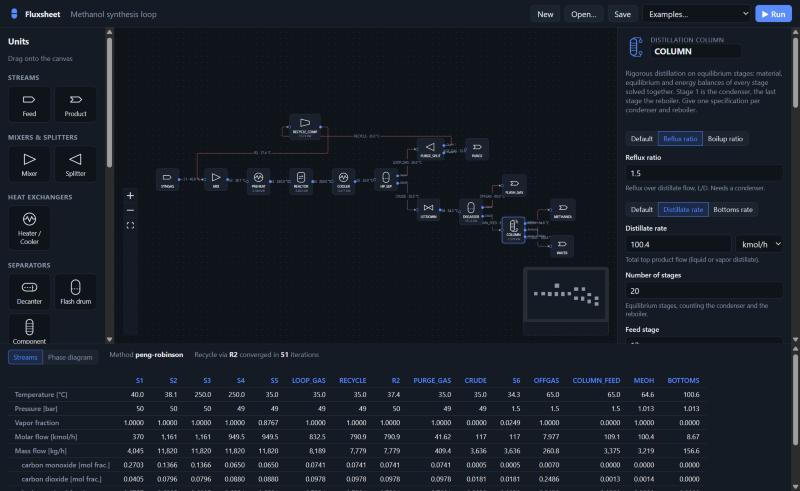

# Fluxsheet

**An open, friendly chemical process simulator.** Draw a flowsheet in the browser, pick your
compounds from a database of ~76,000, and get rigorous phase-equilibrium results, with
error messages that tell you what to do next.



> **Status: early prototype.** Steady-state and sequential-modular, with reactors, columns and
> vapor–liquid–liquid equilibrium. Good for learning and conceptual design; not yet a
> replacement for commercial simulators.

The example in the screenshot, [`examples/methanol_plant.json`](examples/methanol_plant.json),
puts it all together: syngas reacts to methanol in an equilibrium reactor, the unconverted gas
is recompressed and recycled with a purge, and a rigorous column splits the crude into 99.8 %
methanol and water.

## Why another simulator?

Commercial process simulators are powerful but hard to learn, expensive, and closed. Open
alternatives exist, but most are either libraries for programmers or desktop apps with dated
interfaces. Fluxsheet aims for both: a modern editor *and* a clean Python core.

| | |
|---|---|
| **Guides you through property methods** | Picks a thermodynamic model for your components and explains why (e.g. *"water and ethanol are polar, so the liquid is non-ideal, use UNIFAC"*), and warns when your manual choice looks wrong. |
| **Explains every error** | Each error names the unit or stream, says what went wrong, and suggests a fix: *"Valve V1: outlet pressure is above inlet pressure. Hint: a valve can only reduce pressure; use a pump or compressor."* |
| **Values with units** | Type `80 degC`, `1.5 bar`, `10 kmol/h` anywhere, in the editor or in files. |
| **Files you can diff** | Flowsheets are plain, readable JSON. Put them in Git, review changes in pull requests. |
| **Recycles just work** | Tear streams are found automatically and converged with Wegstein acceleration. |
| **Scriptable** | The editor is a thin client over a Python package you can use directly. |

## Quick start

Requires Python ≥ 3.10 and, for the editor, Node.js ≥ 18.

```bash
git clone https://github.com/almi2000/fluxsheet.git
cd fluxsheet
python -m venv .venv
source .venv/bin/activate          # Windows: .venv\Scripts\activate
pip install -e ".[server,dev]"
```

**Run a flowsheet from the command line**

```bash
fluxsheet run examples/ethanol_flash.json
```

```
Property method: unifac
  (water, ethanol are polar, so the liquid is likely non-ideal. ...)

Stream  T [°C]  P [bar]  Vap. frac.  Flow [kmol/h]  Flow [kg/h]
---------------------------------------------------------------
S1       25.00      1.2      0.0000            100         2363
S2       92.00      1.1      0.5052            100         2363
S3       92.00      1.1      1.0000          50.52         1396
S4       92.00      1.1      0.0000          49.48        966.4

HEATER: duty 733.5 kW
```

**Start the web editor**

```bash
cd web && npm install && npm run build && cd ..
fluxsheet serve                # open http://127.0.0.1:8000
```

For editor development, run `fluxsheet serve` and `npm run dev` (in `web/`) side by side,
then open http://localhost:5173.

In the editor, Ctrl/⌘ Z and Ctrl/⌘ Shift Z undo and redo every change, Ctrl/⌘ C / V / D copy,
paste and duplicate the selected units (shift-click or shift-drag to select several; copies also
paste into another editor tab as Fluxsheet JSON), and **Arrange** lays the flowsheet out left to
right. Press `?` for all shortcuts.

**Use it from Python**

```python
from fluxsheet import FlowsheetModel, solve

result = solve(FlowsheetModel.load("examples/gas_recycle.json"))
print(result.streams["NGL-OUT"]["mass_flow"] * 3600, "kg/h")
```

## A flowsheet file

```json
{
  "format": "fluxsheet/1",
  "name": "Ethanol-water flash",
  "components": ["water", "ethanol"],
  "property_method": "auto",
  "units": [
    {"id": "FEED", "type": "Feed",
     "params": {"T": "25 degC", "P": "1.2 bar",
                "flows": {"water": "80 kmol/h", "ethanol": "20 kmol/h"}}},
    {"id": "HEATER", "type": "Heater", "params": {"T": "92 degC", "dP": "0.1 bar"}},
    {"id": "DRUM", "type": "Flash"}
  ],
  "streams": [
    {"id": "S1", "from": "FEED.out", "to": "HEATER.in"},
    {"id": "S2", "from": "HEATER.out", "to": "DRUM.in"},
    {"id": "S3", "from": "DRUM.vapor"},
    {"id": "S4", "from": "DRUM.liquid"}
  ]
}
```

Plain numbers are SI (K, Pa, mol/s, W). A stream without `to` leaves the process.

## Reactions and reactors

Reactions are defined once per flowsheet and picked by id in a reactor. Each is checked for
element balance against the compound database; kinetics and an equilibrium constant are
optional:

```json
"reactions": [
  {"id": "EST",
   "stoichiometry": {"acetic acid": -1, "ethanol": -1, "ethyl acetate": 1, "water": 1},
   "kinetics": {"k0": 2e-7, "Ea": "50 kJ/mol", "T_ref": "70 degC",
                "orders": {"acetic acid": 1, "ethanol": 1}, "equilibrium_limited": true},
   "keq": {"A": 1.386}}
]
```

| Reactor | Model |
|---|---|
| Stoichiometric | Given conversion of a key component per reaction, sequential or parallel |
| Yield | Given product mass yields, scaled to conserve mass |
| Equilibrium | Chosen reactions at equilibrium; K(T) from ΔG°f, ΔH°f and ideal-gas Cp (van 't Hoff), or `ln K = A + B/T + C ln T + D T` |
| Gibbs | Minimum Gibbs energy of an ideal-gas mixture under element balances; no reactions needed |
| CSTR | Power-law kinetics, gas or liquid, solved for the outlet extents (and temperature) |
| Plug flow | Power-law kinetics integrated along volume or length, with conversion, temperature and composition profiles |

All reactors run isothermal, adiabatic or at a given duty, with an optional pressure drop.
The energy balance uses enthalpies that include formation enthalpies, so heats of reaction
need no separate input. See `examples/steam_reforming.json` and
`examples/ethyl_acetate.json`, and [reactions.py](src/fluxsheet/reactions.py) for units
and conventions.

## What's included

**Unit operations:** Feed, Product, Mixer, Splitter, Heater/Cooler, Flash drum, Decanter
(liquid-liquid), Component splitter, Valve, Pump, Compressor.

**Columns:** shortcut distillation design (Fenske, Underwood, Gilliland/Molokanov,
Kirkbride); rigorous distillation on equilibrium stages (MESH equations solved together by
Newton's method, Naphtali-Sandholm) with total, partial or no condenser, optional reboiler,
stage pressure drop and Murphree efficiency; absorber/stripper on the same stage model.
Stage profiles (temperature, flows, compositions) show up in the inspector.

**Property methods:**

| Method | Use for |
|---|---|
| Peng-Robinson | Hydrocarbons, light gases, high pressure (ChemSep binary parameters) |
| Soave-Redlich-Kwong | Same territory, common in gas processing |
| UNIFAC (Dortmund) | Polar, non-ideal liquids at low/moderate pressure (water, alcohols, ketones…) |
| NRTL | Non-ideal liquids, azeotropes and liquid-liquid splits, with ChemSep binary parameters |
| UNIQUAC | Same territory as NRTL; ChemSep parameters, size/surface from UNIFAC groups |
| Wilson | Miscible polar mixtures (cannot represent a liquid-liquid split) |
| Ideal (Raoult) | Similar molecules at low pressure; single compounds |

NRTL, UNIQUAC and UNIFAC flashes find a second liquid phase when there is one (vapor-liquid-
liquid equilibrium). Binary pairs missing from ChemSep are estimated by fitting to UNIFAC, and
every solve that uses such an estimate says so in its warnings. The **Phase diagram** view in the
results panel plots T-xy and P-xy diagrams of any two components (with azeotropes and
liquid-liquid regions) and phase envelopes of mixtures with an equation of state.

Thermodynamics and compound data come from the excellent MIT-licensed
[`thermo`](https://github.com/CalebBell/thermo) and
[`chemicals`](https://github.com/CalebBell/chemicals) libraries by Caleb Bell. See
[docs/data-sources.md](docs/data-sources.md) for where the data comes from and how we plan to
extend it.

## Roadmap

- [x] Distillation: shortcut column (Fenske–Underwood–Gilliland), then rigorous MESH column
- [x] Reactors: stoichiometric, yield, equilibrium, Gibbs, CSTR/PFR with kinetics
- [x] NRTL / UNIQUAC / Wilson with regressed (ChemSep) binary parameters, UNIFAC estimates for gaps
- [ ] Parameter fitting from NIST ThermoML data
- [x] Vapor–liquid–liquid equilibrium (decanters, three-phase flash)
- [ ] Heat exchanger (two-sided), design specs, sensitivity studies
- [x] Phase envelopes, T-xy / P-xy diagrams in the editor
- [x] Undo/redo, copy/paste, auto-layout in the editor
- [ ] CAPE-OPEN interoperability

## Project layout

```
src/fluxsheet/   Python core: compounds, thermo, reactions, units, column solver, CLI, HTTP API
web/             React + React Flow editor
examples/        Example flowsheets (also loadable in the editor)
tests/           pytest suite
docs/            Architecture and data-source notes
```

More in [docs/architecture.md](docs/architecture.md). Contributions are welcome, see
[CONTRIBUTING.md](CONTRIBUTING.md).

## License

[MIT](LICENSE). Fluxsheet is an independent project, not affiliated with or derived from
any commercial simulator.
